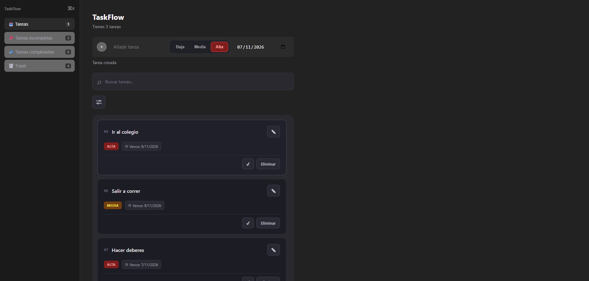

# TaskFlow

### Organize your tasks. Manage your priorities. Take control of your time.

TaskFlow is a task management application built with **React, TypeScript, and Symfony**, designed to make everyday work organization easier through an intuitive interface and tools for managing, categorizing, and tracking tasks.

This project is an opportunity to put frontend and backend development concepts into practice, including component architecture, custom React hooks, state management, authentication, and API communication.

---

## Overview

**TaskFlow v0.5.1** introduces an authentication system integrated with Symfony Security, allowing users to register and sign in using server-side session-based authentication.

The project is evolving towards a frontend-backend architecture, keeping React and TypeScript on the client side while using Symfony as the backend.

## Screenshots

### Dashboard
Vista principal de la aplicación y gestión de tareas.



### Barra lateral
Navegación y acceso a las diferentes secciones de la aplicación.


### Filtros
Organización de las tareas según su estado.


---

## Main Features

### Task Management

- **Task CRUD:** create, edit, and delete tasks.
- **Priorities:** classify tasks as low, medium, or high priority.
- **Due dates:** assign and modify task deadlines.
- **Overdue task detection:** visually identify tasks whose due dates have passed.
- **Search:** find tasks by title.
- **Filters:** display all tasks, pending tasks, completed tasks, and trashed tasks.
- **Sorting:** organize tasks by name, priority, and due date.
- **Trash management:** soft deletion, task restoration, and permanent deletion.
- **Local persistence:** store tasks using LocalStorage.

### Authentication and User Management

- **User registration:** create accounts through the Symfony backend.
- **Login:** authenticate users using Symfony Security.
- **Session management:** maintain authentication through PHP sessions and cookies.
- **Current user retrieval:** retrieve authenticated user information through the `/api/me` endpoint.
- **Frontend-backend communication:** configure CORS and credentialed requests to handle session cookies.

---

## Technologies Used

| Technology       | Purpose                                |
| ---------------- | -------------------------------------- |
| React            | User interface development             |
| TypeScript       | Static typing                          |
| Vite             | Development environment and build tool |
| CSS              | Styling and layout                     |
| Symfony          | Backend and server-side logic          |
| PHP              | Backend programming language           |
| Symfony Security | Authentication and session management  |
| MySQL            | Database                               |
| LocalStorage     | Local task persistence                 |
| Git              | Version control                        |

---

## Installation and Setup

### Requirements

- Node.js and npm.
- PHP and Composer.
- Symfony CLI (recommended).
- MySQL and Docker for the configured database environment.

### 1. Clone the repository

```bash
git clone https://github.com/DavidAguileraDev/TaskFlow.git
```

### 2. Navigate to the project directory

```bash
cd TaskFlow
```

### 3. Install frontend dependencies

```bash
npm install
```

### 4. Install backend dependencies

```bash
cd api/backend_taskflow
composer install
```

### 5. Configure the environment

Configure the backend environment variables, including the database connection and application secret.

Do not commit `.env.local`, `.env.dev.local`, or any files containing private credentials.

### 6. Start the Symfony server

From the backend directory:

```bash
symfony server:start
```

### 7. Start the React development server

From the project root directory:

```bash
npm run dev
```

Vite will provide a local URL to access the application through your browser.

---

## Project Structure

The project is organized to separate responsibilities and make the application easier to maintain and extend.

### Frontend

```text
src/
├── componentes/
├── dashboard/
│   ├── componentes-dashboard/
│   ├── App.tsx
│   └── app.css
├── login/
│   ├── sign-in/
│   │   └── App.tsx
│   └── sign-up/
│       └── App.tsx
├── hooks/
├── types/
├── utils/
├── App.tsx
└── main.tsx
```

- **componentes:** reusable UI components.
- **dashboard:** main task management interface.
- **login:** registration and sign-in pages.
- **hooks:** reusable application logic through custom React hooks.
- **types:** TypeScript interfaces and types.
- **utils:** helper functions independent of UI components.
- **App.tsx:** application routing configuration.
- **main.tsx:** React entry point.

### Backend

```text
api/
└── backend_taskflow/
    ├── config/
    ├── public/
    ├── src/
    │   ├── Controller/
    │   ├── Entity/
    │   └── Security/
    ├── migrations/
    └── ...
```

- **Controller:** API endpoints and request handling.
- **Entity:** database entities and data models.
- **Security:** authentication handlers and security-related logic.
- **config:** Symfony and service configuration.
- **migrations:** database migrations.

---

## Authentication

Authentication is handled by Symfony Security using server-side sessions.

The frontend communicates with the backend through HTTP requests and uses `credentials: "include"` to allow session cookies to be sent and received.

The following API endpoints are currently implemented:

| Method | Endpoint        | Description                               |
| ------ | --------------- | ----------------------------------------- |
| POST   | `/api/sign-up`  | Register a new user                       |
| POST   | `/api/sign-in`  | Authenticate a user                       |
| GET    | `/api/me`       | Retrieve the currently authenticated user |

Custom React hooks separate authentication logic from retrieving and maintaining the current user's information.

---

## Roadmap

| Version | Goal                                                                                    | Status    |
| ------- | --------------------------------------------------------------------------------------- | --------- |
| v0.5.0  | Priorities, due dates, search, sorting, and overdue task detection                      | Completed |
| v0.5.1  | Symfony Security integration, session-based authentication, and current user management | Completed |

### Coming Next: v0.6.0

The next version will focus on improving user management and access control:

- Implement protected routes.
- Redirect unauthenticated users to the sign-in page.
- Centralize authentication state and current user information.
- Improve session handling and logout functionality.

### Future Development

Further development will focus on evolving TaskFlow into a complete frontend-backend application:

- Create API endpoints for task management.
- Integrate task data with the MySQL database.
- Replace LocalStorage with server-side persistence.
- Implement user-specific task management.
- Improve application architecture and maintainability.

The long-term goal is to build a complete task management application with user authentication, database persistence, and a scalable frontend-backend architecture.

---

## Author

Personal project developed as part of my learning journey and continuous growth in web development.

**TaskFlow — Personal Web Development Project.**

---

\<sub>Current version: v0.5.1 · Actively under development.\</sub>
