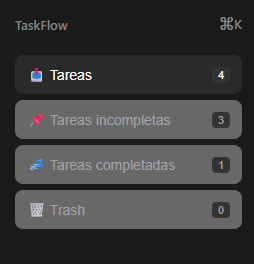
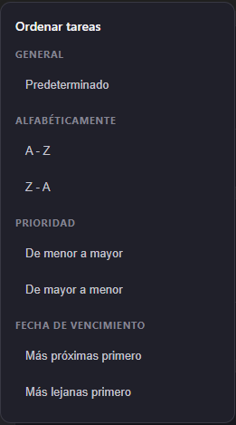

# TaskFlow

### Organiza tus tareas. Controla tus prioridades. Gestiona tu tiempo.

TaskFlow es una aplicación de gestión de tareas desarrollada con **React, TypeScript y Symfony**, diseñada para facilitar la organización del trabajo diario mediante una interfaz intuitiva y herramientas que permiten gestionar, clasificar y supervisar tareas.

El proyecto nace como una oportunidad para poner en práctica conceptos de desarrollo frontend y backend, arquitectura de componentes, hooks personalizados, gestión del estado, autenticación y comunicación entre aplicaciones mediante API REST.

---

## Vista general

**TaskFlow v5.1** incorpora un sistema de autenticación integrado con Symfony Security, permitiendo registrar usuarios e iniciar sesión mediante autenticación basada en sesiones.

El proyecto continúa evolucionando hacia una arquitectura frontend-backend, manteniendo React y TypeScript en el cliente y utilizando Symfony como backend.

## Capturas de pantalla

### Dashboard

Vista principal de la aplicación y gestión de tareas.


### Barra lateral

Navegación y acceso a las diferentes secciones de la aplicación.



### Filtros

Organización de las tareas según su estado.



---

## Funcionalidades principales

### Gestión de tareas

- **Gestión de tareas (CRUD):** creación, edición y eliminación de tareas.
- **Prioridades:** clasificación en prioridad baja, media y alta.
- **Fechas de vencimiento:** asignación y modificación de fechas límite.
- **Detección de tareas vencidas:** identificación visual de tareas cuya fecha de vencimiento ha pasado.
- **Buscador:** búsqueda de tareas por título.
- **Filtros:** visualización de todas las tareas, pendientes, completadas y papelera.
- **Ordenación:** organización por nombre, prioridad y fecha de vencimiento.
- **Papelera:** eliminación lógica, restauración y eliminación permanente de tareas.
- **Persistencia local:** almacenamiento de las tareas mediante LocalStorage.

### Autenticación y usuarios

- **Registro de usuarios:** creación de cuentas mediante el backend Symfony.
- **Inicio de sesión:** autenticación mediante Symfony Security.
- **Gestión de sesiones:** mantenimiento de la autenticación mediante sesiones PHP y cookies.
- **Consulta del usuario actual:** recuperación de los datos del usuario autenticado mediante el endpoint `/api/me`.
- **Comunicación segura entre frontend y backend:** configuración de CORS y envío de cookies con credenciales.

---

## Tecnologías utilizadas

| Tecnología | Uso |
|---|---|
| React | Construcción de la interfaz |
| TypeScript | Tipado estático |
| Vite | Entorno de desarrollo y compilación |
| CSS | Diseño y estilos |
| Symfony | Backend y lógica de servidor |
| PHP | Lenguaje del backend |
| Symfony Security | Autenticación y gestión de sesiones |
| MySQL | Base de datos |
| LocalStorage | Persistencia local de tareas |
| Git | Control de versiones |

---

## Instalación y ejecución

### Requisitos

- Node.js y npm.
- PHP y Composer.
- Symfony CLI (recomendado).
- MySQL y Docker para el entorno de base de datos configurado.

### 1. Clonar el repositorio

```bash
git clone https://github.com/DavidAguileraDev/TaskFlow.git
```

### 2. Acceder al proyecto

```bash
cd TaskFlow
```

### 3. Instalar las dependencias del frontend

```bash
npm install
```

### 4. Instalar las dependencias del backend

```bash
cd api/backend_taskflow
composer install
```

### 5. Configurar el entorno

Configura las variables de entorno del backend, incluyendo la conexión a la base de datos y el secreto de la aplicación.

No incluyas archivos `.env.local`, `.env.dev.local` ni credenciales privadas en el repositorio.

### 6. Iniciar Symfony

Desde el directorio del backend:

```bash
symfony server:start
```

### 7. Iniciar React

Desde la raíz del proyecto:

```bash
npm run dev
```

Vite proporcionará una dirección local para acceder a la aplicación desde el navegador.

---

## Estructura del proyecto

El código está organizado para separar responsabilidades y facilitar el mantenimiento y la ampliación de la aplicación.

### Frontend

```text
src/
├── componentes/
├── dashboard/
│   ├── App.tsx
│   └── app.css
├── login/
│   ├── sign-in/
│   │   └── App.tsx
│   └── sign-up/
│       └── App.tsx
├── hooks/
├── types/
├── utils/
├── App.tsx
└── main.tsx
```

- **componentes:** componentes visuales reutilizables.
- **dashboard:** interfaz principal de gestión de tareas.
- **login:** pantallas de registro e inicio de sesión.
- **hooks:** lógica reutilizable mediante hooks personalizados de React.
- **types:** interfaces y tipos de TypeScript.
- **utils:** funciones auxiliares independientes de los componentes.
- **App.tsx:** configuración de las rutas de la aplicación.
- **main.tsx:** punto de entrada de React.

### Backend

```text
api/
└── backend_taskflow/
    ├── config/
    ├── public/
    ├── src/
    │   ├── Controller/
    │   ├── Entity/
    │   └── Security/
    ├── migrations/
    └── ...
```

- **Controller:** endpoints y lógica de comunicación con el frontend.
- **Entity:** entidades y modelos de datos.
- **Security:** configuración y gestión de la autenticación.
- **config:** configuración de Symfony y sus servicios.
- **migrations:** migraciones de la base de datos.

---

## Autenticación

La autenticación está gestionada por Symfony Security mediante sesiones del servidor.

El frontend realiza peticiones HTTP al backend y utiliza `credentials: "include"` para permitir el envío y la recepción de las cookies de sesión.

Actualmente se utilizan los siguientes endpoints:

| Método | Endpoint | Función |
|---|---|---|
| POST | `/api/sign-up` | Registrar un usuario |
| POST | `/api/sign-in` | Iniciar sesión |
| GET | `/api/me` | Consultar el usuario autenticado |
| POST | `/api/sign-out` | Cerrar sesión |

En React, los hooks personalizados permiten separar la lógica de autenticación de la consulta de los datos del usuario actual.

---

## Hoja de ruta

| Versión | Objetivo | Estado |
|---|---|---|
| v0.5 | Prioridades, fechas, búsqueda, ordenación y detección de vencimientos | Completada |
| v5.1 | Integración de Symfony Security, autenticación mediante sesiones y hooks de usuario | Completada |
| v5.2 | Protección de rutas y gestión global del usuario autenticado | Pendiente |
| v5.3 | API para la gestión de tareas e integración completa con MySQL | Pendiente |

### Próximos objetivos

La siguiente etapa estará centrada en seguir evolucionando la arquitectura de la aplicación:

- Implementar la protección de rutas para usuarios no autenticados.
- Centralizar el estado de autenticación y los datos del usuario.
- Crear los endpoints necesarios para gestionar las tareas.
- Conectar las tareas con la base de datos MySQL.
- Sustituir progresivamente LocalStorage por persistencia en el servidor.
- Implementar la gestión de sesiones y el cierre de sesión desde React.

El objetivo es evolucionar TaskFlow hacia una aplicación completa con arquitectura frontend-backend, autenticación de usuarios y persistencia de datos en el servidor.

---

## Autor

Proyecto personal desarrollado como parte de mi aprendizaje y evolución en el desarrollo web.

**TaskFlow — Proyecto personal de desarrollo web.**

---

<sub>Versión actual: v5.1 · En desarrollo continuo.</sub>