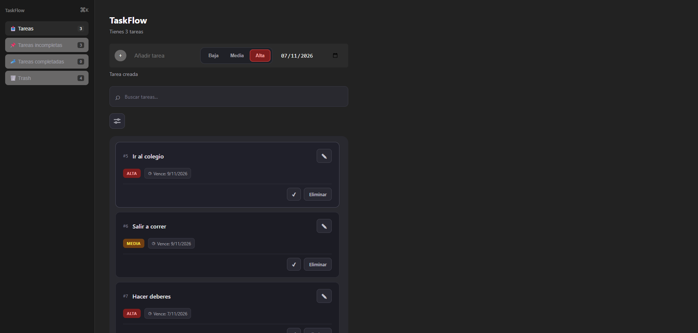
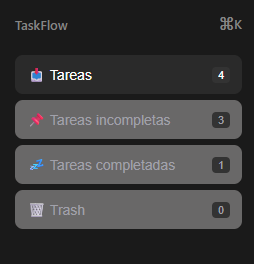
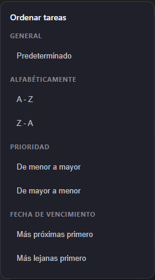

# TaskFlow

### Organiza tus tareas. Controla tus prioridades. Gestiona tu tiempo.

TaskFlow es una aplicación de gestión de tareas desarrollada con **React y TypeScript**, diseñada para facilitar la organización del trabajo diario mediante una interfaz intuitiva y herramientas que permiten gestionar, clasificar y supervisar tareas.

El proyecto nace como una oportunidad para poner en práctica conceptos de desarrollo frontend, arquitectura de componentes, hooks personalizados y gestión del estado en React.

---

## Vista general

**TaskFlow v0.5.0** incorpora un sistema de gestión de tareas con prioridades, fechas de vencimiento, búsqueda, filtros y diferentes criterios de ordenación.

## Capturas de pantalla

### Dashboard
Vista principal de la aplicación y gestión de tareas.



### Barra lateral
Navegación y acceso a las diferentes secciones de la aplicación.



### Filtros
Organización de las tareas según su estado.



---

## Funcionalidades principales

- **Gestión de tareas (CRUD):** creación, edición y eliminación de tareas.
- **Prioridades:** clasificación en prioridad baja, media y alta.
- **Fechas de vencimiento:** asignación y modificación de fechas límite.
- **Detección de tareas vencidas:** identificación visual de tareas cuya fecha de vencimiento ha pasado.
- **Buscador:** búsqueda de tareas por título.
- **Filtros:** visualización de todas las tareas, pendientes, completadas y papelera.
- **Ordenación:** organización por nombre, prioridad y fecha de vencimiento.
- **Papelera:** eliminación lógica, restauración y eliminación permanente de tareas.
- **Persistencia local:** almacenamiento mediante LocalStorage.

## Tecnologías utilizadas

| Tecnología | Uso |
|---|---|
| React | Construcción de la interfaz |
| TypeScript | Tipado estático |
| Vite | Entorno de desarrollo y compilación |
| CSS | Diseño y estilos |
| LocalStorage | Persistencia local |
| Git | Control de versiones |

---

## Instalación y ejecución

Requisitos: Node.js y npm.

1. Clona el repositorio:

```bash
git clone URL_DE_TU_REPOSITORIO
```

2. Accede al proyecto:

```bash
cd TaskFlow
```

3. Instala las dependencias:

```bash
npm install
```

4. Inicia el servidor:

```bash
npm run dev
```

Vite proporcionará una dirección local para acceder a la aplicación desde el navegador.

---

## Estructura del proyecto

El código está organizado para separar responsabilidades y facilitar el mantenimiento y la ampliación de la aplicación.

```text
src/
├── hooks/
├── index/
│   ├── componentes/
│   └── constantes/
├── types/
└── utils/
```

- **hooks:** lógica reutilizable mediante hooks personalizados de React.
- **index/componentes:** componentes visuales de la aplicación.
- **index/constantes:** constantes y configuraciones utilizadas por el proyecto.
- **types:** interfaces y tipos de TypeScript.
- **utils:** funciones auxiliares independientes de los componentes.

---

## Hoja de ruta

| Versión | Objetivo | Estado |
|---|---|---|
| v0.5 | Prioridades, fechas, búsqueda, ordenación y detección de vencimientos de tareas | Completada |
| v0.6 | Integración de Symfony y base de datos | Planificada |

### Próximamente: v0.6.0

La siguiente versión estará centrada en evolucionar la arquitectura de la aplicación:

- Incorporación de **Symfony** como backend.
- Creación de una API para gestionar las tareas.
- Integración de una base de datos.
- Comunicación entre React y Symfony mediante peticiones HTTP.
- Sustitución progresiva de LocalStorage por persistencia en el servidor.

El objetivo será evolucionar TaskFlow hacia una arquitectura frontend-backend, manteniendo React y TypeScript en el cliente.

---

## Autor

Proyecto personal desarrollado como parte de mi aprendizaje y evolución en el desarrollo web.

**TaskFlow — Proyecto personal de desarrollo web.**

---

<sub>Versión actual: v0.5.0 · En desarrollo continuo.</sub>